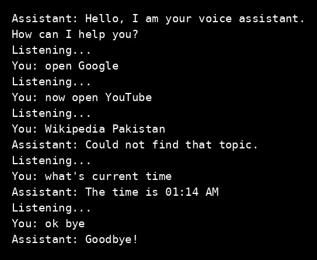

# Voice Assistant

Task name: Voice Assistant
Track: Python Programming, Oasis Infobyte OIB-SIP, ref OIB/O2/IP8101

## What this program does

This program listens to voice commands through the microphone, understands them, and replies both by speaking and by printing the reply on screen. It keeps listening in a loop until a stop command is given.

## How to run

Install the libraries first, then run the program with Python on a machine with a working microphone.

```
python voice_assistant.py
```

## Commands

- Greeting: the assistant greets you when it starts.
- Time: ask for the current time.
- Wikipedia: ask for a short two-sentence summary of a topic.
- Open YouTube: opens YouTube in the browser.
- Open Google: opens Google in the browser.
- Stop / exit / bye: the assistant says goodbye and exits cleanly.

## Features

- Speech recognition with a microphone, using Google speech recognition (needs internet).
- Spoken replies with pyttsx3, and every reply is also printed so it shows in the demo.
- If speech cannot be understood, it says so politely and listens again without crashing.
- If a command is not recognised, it repeats what it heard and keeps listening.
- If a Wikipedia topic cannot be found, it says so instead of crashing.

## Libraries used

- speech_recognition, with PyAudio for the microphone
- pyttsx3 for text to speech
- wikipedia for short summaries
- datetime and webbrowser from the Python standard library

## Mic setup

Tested on Windows with a laptop microphone. Check in Windows sound settings that the microphone is on and picks up your voice before running the program.

## Output screenshot



Tested example from the demo run: "what's current time" gave "The time is 01:14 AM", "open Google" opened google.com, "now open YouTube" opened youtube.com, and "ok bye" gave "Goodbye!" and exited.
