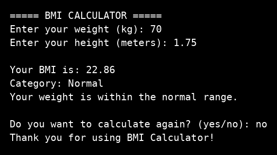

# BMI Calculator

Task name: BMI Calculator
Track: Python Programming, Oasis Infobyte OIB-SIP, ref OIB/O2/IP8101

## What this program does

This program asks for weight in kilograms and height in meters, calculates BMI, and shows the BMI category. It checks invalid input and does not crash on wrong input.

## How to run

Run the program with Python, then enter weight and height when asked.

```
python bmi_calculator.py
```

## Features

- Weight and height input in kg and meters
- BMI calculation, shown to 2 decimal places
- Category: Underweight, Normal, Overweight, or Obese
- Invalid input handling for text, zero, and negative values
- Option to calculate again

## Output screenshot



Tested examples: 70 kg and 1.75 m gives BMI 22.86, Normal. 50 kg and 1.70 m gives BMI 17.30, Underweight. 90 kg and 1.70 m gives BMI 31.14, Obese.
