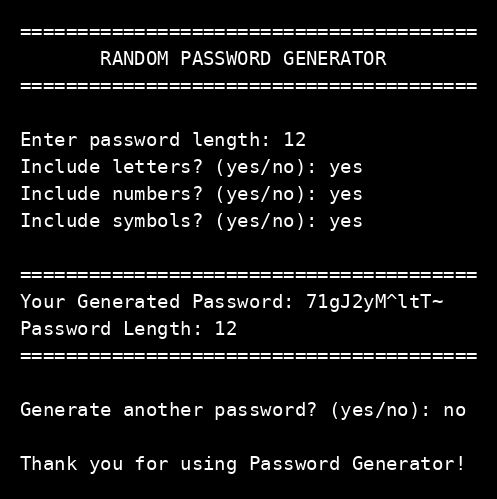

# Random Password Generator

Task name: Random Password Generator
Track: Python Programming, Oasis Infobyte OIB-SIP, ref OIB/O2/IP8101

## What this program does

This program asks for a password length and character types, then generates a random password of that length. It checks invalid input and does not crash on wrong input.

## How to run

Run the program with Python, then enter the length and answer yes or no for letters, numbers, and symbols.

```
python random_password_generator.py
```

## Features

- Password length chosen by the user
- Letters, numbers, and symbols, each optional, with at least one type required
- Invalid input handling for text, zero, and negative length, and for answers other than yes or no
- Option to generate another password

## Security note

The random module is fine for this beginner task. For real security, the secrets module is better.

## Output screenshot



Tested examples: length 12 with letters, numbers, and symbols gave a 12-character password. Length 8 with letters only gave an 8-letter password. Length 16 with numbers only gave a 16-digit password.
